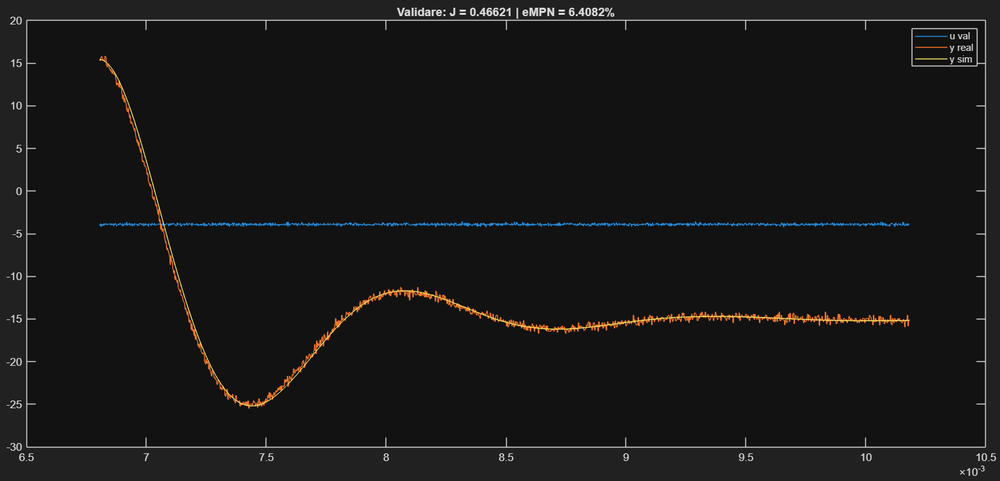
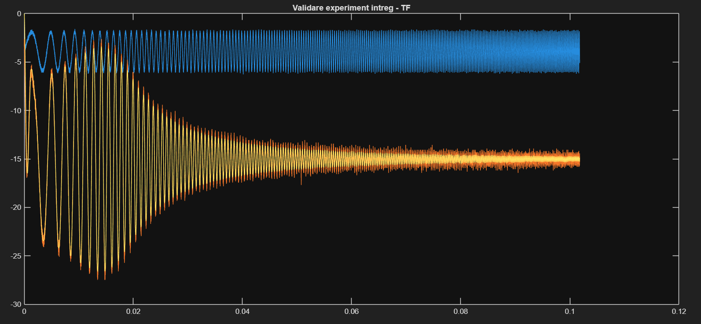
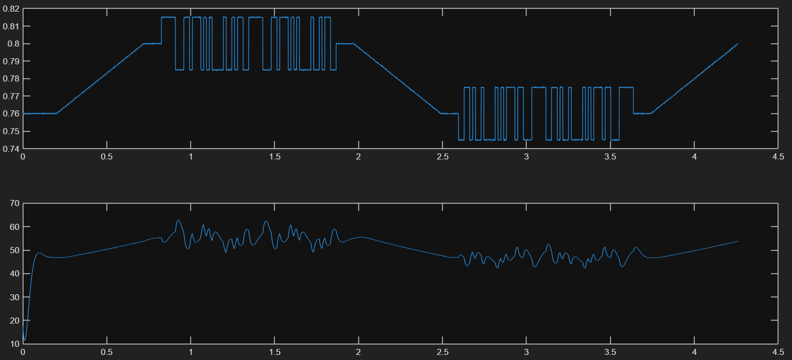
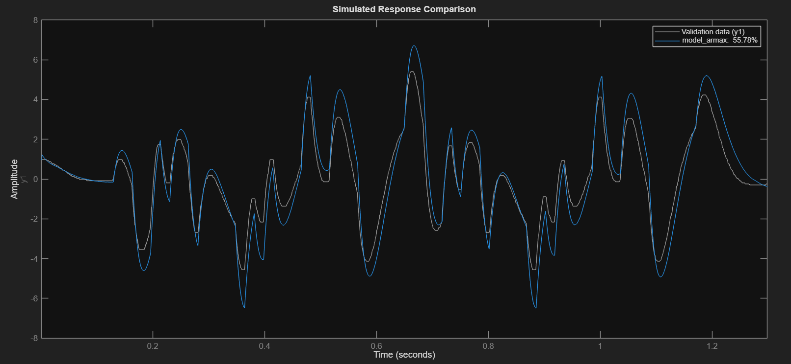
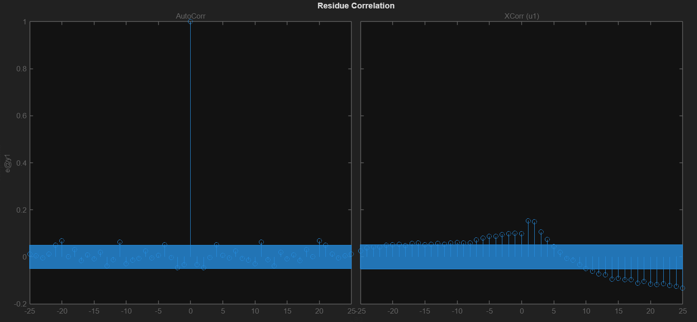

# System Identification of Dynamic Processes

Experimental identification of linear models for three processes, using non-parametric and
parametric methods in MATLAB/Simulink, with validation on separate data.

University project, *System Identification*, Technical University of Cluj-Napoca (2025).

| Process | Method | Result |
|---|---|---|
| Sallen-Key low-pass filter (2nd order, underdamped) | Linear regression on the step response | Validation error 6.4 % (NMSE) |
| Sallen-Key low-pass filter | Frequency response from a chirp input | Accurate up to resonance, ~11 % error at high frequency |
| DC-DC boost converter (nonlinear) | PRBS excitation + parametric models | Best fit 55.8 % (ARMAX), explained below |

## 1. Step response + linear regression

Model: H(s) = K·ωn² / (s² + 2ζωn·s + ωn²).

- **K** from the steady-state gain over two step levels.
- **Real part of the poles** from linear regression on the logarithm of the oscillation peaks
  (the envelope decays as e^(−ζωn·t)).
- **Imaginary part** from the measured oscillation frequency, then ζ and ωn from both.
- Validated in state space with non-zero initial conditions, on data not used for identification.

## 2. Chirp input + frequency response

- A linear chirp around the operating point sweeps through the resonance.
- **K** from the low-frequency amplitude ratio, **resonance peak Mr** and **resonant frequency ωr**
  from the region of maximum amplification, then ζ and ωn.
- Accurate in the main operating range; errors of 11–12 % appear after resonance, where measurement
  noise affects the readings.

## 3. PRBS excitation + parametric identification (boost converter)

**Experiment design.** A trapezoidal input sets two nearby operating points (identification and
validation) and a small-amplitude pseudo-random binary signal (PRBS, N = 5) is superimposed to excite
the dynamics without leaving the region where a linear model is valid.

**Preprocessing.** Mean removal, decimation (factor 19) and a median filter against impulsive noise.

**Models compared** (System Identification Toolbox): ARX, ARMAX, OE, BJ, IV4, FIR, PEM, N4SID,
SSEST, SSREGEST, TFEST — each validated by fit on separate data (`compare`) and by the residual
correlation test appropriate to the method (`resid`).

| Model | Fit on validation data |
|---|---|
| ARMAX | 55.8 % |
| OE | 49.9 % |
| N4SID | 46.4 % |

**Why the fit is limited.** The models follow the general trend but not every dynamic detail, which is
expected for this process:

- **Nonlinearity:** the boost converter is a switched system with V_out = V_in / (1 − μ); a linear
  time-invariant model is valid only in a small neighbourhood of the operating point, and identification
  and validation use two different operating points.
- **Non-minimum phase:** the duty-cycle-to-output transfer function has a right-half-plane zero —
  the output first drops when the duty cycle increases, then rises. Low-order models struggle to capture
  both this inverse response and the steady state.
- **Parasitic effects:** capacitor ESR and inductor resistance are not captured by a black-box model.

The resulting models are adequate as a basis for designing a robust feedback controller.

## Repository contents

| File | Description |
|---|---|
| `matlab/p1_step_regression_sallen_key.m` | Step experiment, regression, validation |
| `matlab/p2_chirp_frequency_response_sallen_key.m` | Chirp experiment, frequency-response identification |
| `matlab/p3_prbs_parametric_boost_converter.m` | PRBS design, preprocessing, parametric models |
| `media/` | Validation plots |

The Simulink process models and the input-generation helper were provided by the course and are not
included, so the scripts document the method rather than run standalone.

## Tools

MATLAB · Simulink · System Identification Toolbox
